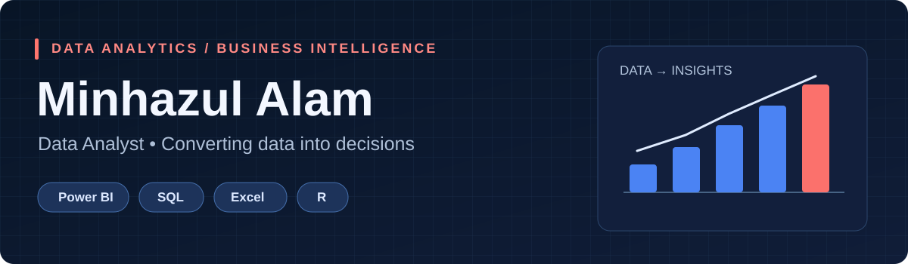
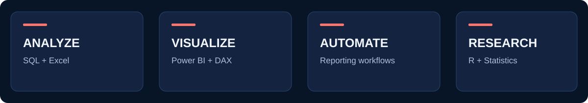

### Turning complex data into clear, actionable insights

**Excel · Power BI · SQL · R · Data Visualization · Reporting**

## 01 / About Me

I am **Minhazul Alam**, a data analyst with an interest in turning data into practical business intelligence. My toolkit includes **Excel, Power BI, SQL, and R** for data cleaning, exploration, visualization, reporting, and statistical analysis.

I enjoy creating dashboards and analyses that help people understand performance, recognize patterns, and make informed decisions.

## 02 / Technical Toolkit

| Area | Tools and capabilities |
|:--|:--|
| **Dashboards & BI** | Power BI, DAX, data visualization, KPI reporting |
| **Data Analysis** | Excel, PivotTables, Power Query, exploratory analysis |
| **Databases** | SQL, PostgreSQL, relational queries |
| **Statistics & Research** | R, statistical analysis, data visualization |
| **Reporting** | Data storytelling, recurring reports, performance insights |

## 03 / Selected Work

> Project links and screenshots will be added once their public repositories are confirmed. The items below describe portfolio areas, not claims of published repositories.

| Portfolio area | What to showcase |
|:--|:--|
| **Power BI Dashboards** | Interactive reports, performance KPIs, DAX measures, and dashboard screenshots |
| **SQL Analysis** | PostgreSQL queries for cleaning, joins, aggregation, and exploratory insights |
| **Excel Analytics** | Interactive reporting, automated workflows, and analysis models |
| **R Statistical Analysis** | Research-oriented plots, statistical methods, and interpretation |

## 04 / Professional Experience

**Data Analyst — Quasem Foundation**  
Business data analysis, reporting, and decision support.

*Add verified dates, previous roles, responsibilities, and measurable achievements before publishing.*

## 05 / Current Goals

- Build clear, practical, decision-ready analytics products.
- Publish documented projects with reproducible methods.
- Share dashboards, case studies, and analytical insights.

## 06 / Let's Connect

**GitHub:** [minhaz6996](https://github.com/minhaz6996)  
**LinkedIn:** *Add your verified profile URL*  
**Portfolio Website:** *Add when published*

---

Designed for GitHub profile README · All project links and metrics should be verified before publishing.

