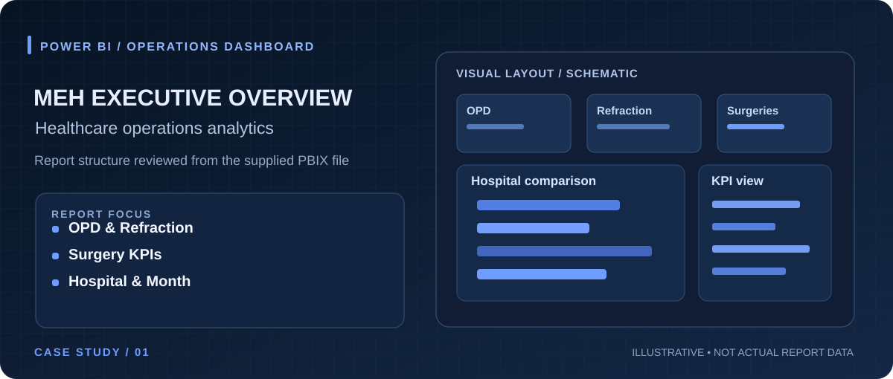
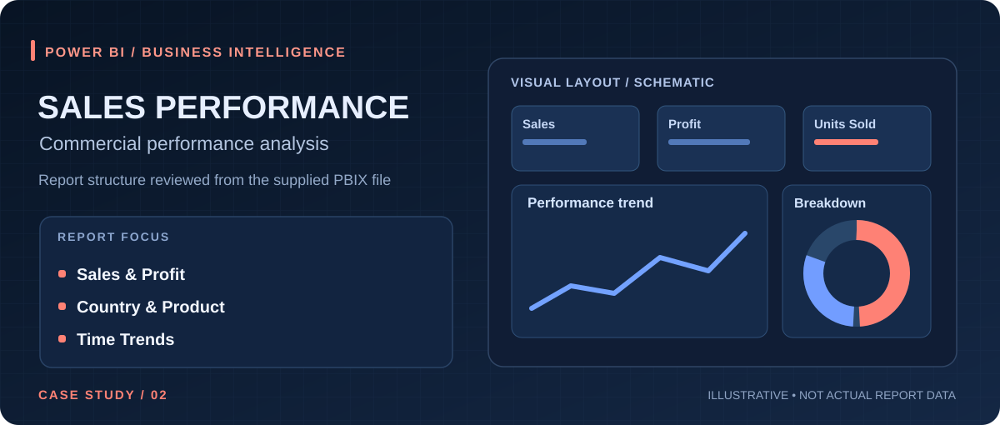

### Turning complex data into clear, actionable insights

**Excel · Power BI · SQL · R · Data Visualization · Reporting**

## 01 / About Me

I am **Minhazul Alam**, a data analyst working with **Power BI, Excel, SQL, and R** to turn information into useful reports, dashboards, and analysis. My interests include business intelligence, performance monitoring, statistical research, and clear data storytelling.

## 02 / Featured Power BI Case Studies

### 🏥 MEH Executive Overview — Healthcare Operations

**Focus:** Hospital-level operational reporting across **OPD, refraction, and surgery-related KPIs**, with hospital/month filtering, comparison charts, and a summary matrix.  
**Tools:** Power BI, report modeling, KPI design, filters, and visual reporting.  
**[Explore the project →](projects/meh-executive-overview/README.md)**

### 📊 Sales Performance Overview — Business Analytics

**Focus:** Sales, profit, costs, units sold, and profit-margin analysis using breakdowns by **country, product, segment, and time**.  
**Tools:** Power BI, KPI reporting, slicers, bar/line/donut visualizations.  
**[Explore the project →](projects/sales-performance-overview/README.md)**

> **Portfolio note:** The visuals above are illustrative case-study graphics, **not direct screenshots of the PBIX reports**. Project descriptions were prepared by inspecting the report definitions. No confidential data or actual KPI values have been published here.

## 03 / Technical Toolkit

| Area | Tools and capabilities |
|:--|:--|
| **Business Intelligence** | Power BI, KPI reporting, dashboard design, DAX concepts |
| **Analysis & Reporting** | Excel, PivotTables, Power Query, performance reporting |
| **Data Queries** | SQL, PostgreSQL, joins, aggregations, exploratory queries |
| **Statistics & Research** | R, statistical methods, charts, research analysis |
| **Communication** | Data visualization, reporting workflows, data storytelling |

## 04 / Professional Experience

**Data Analyst — Quasem Foundation**  
Business reporting, analytical work, and decision support.  
*Detailed dates and measurable achievements will be added after verification.*

## 05 / Upcoming Work

- Document SQL and Excel projects with reproducible examples.
- Add approved, anonymized Power BI report screenshots if sharing is authorized.
- Publish R statistical analysis case studies.

## 06 / Connect

**GitHub:** [minhaz6996](https://github.com/minhaz6996)  
**LinkedIn:** [Professional profile](https://www.linkedin.com/in/minhazul-alam-9a08b8263/)

---

Minhazul Alam · Data Analytics & Business Intelligence · Case studies reflect inspected report structure, not verified operational results.

